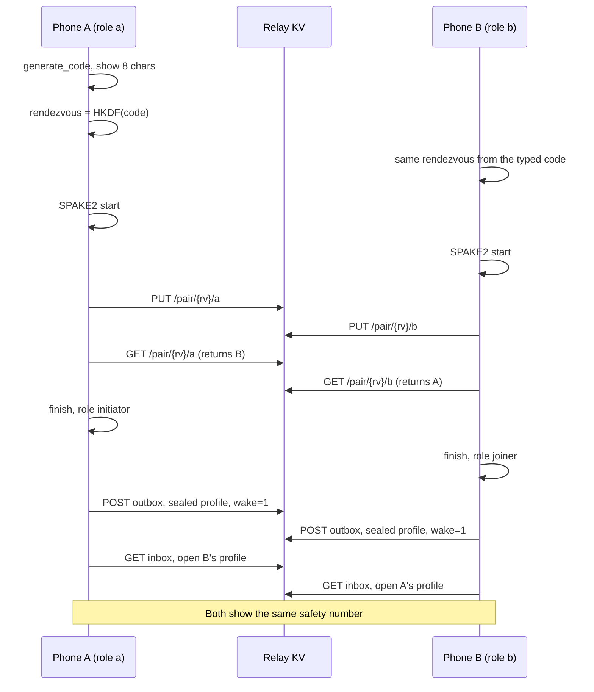
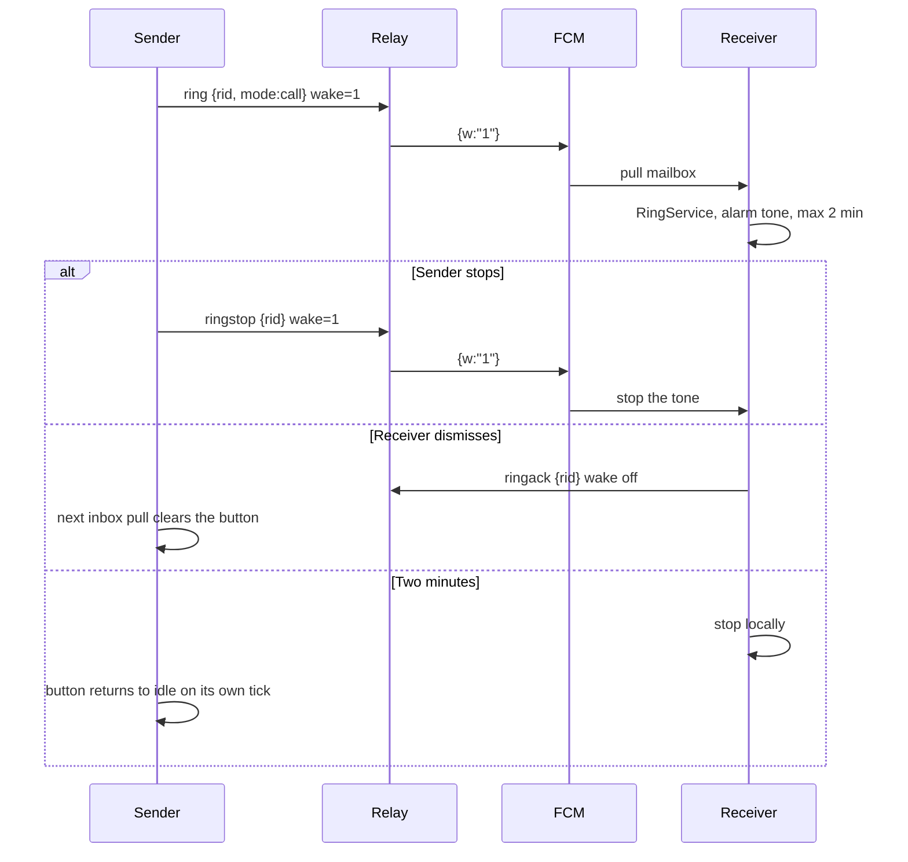
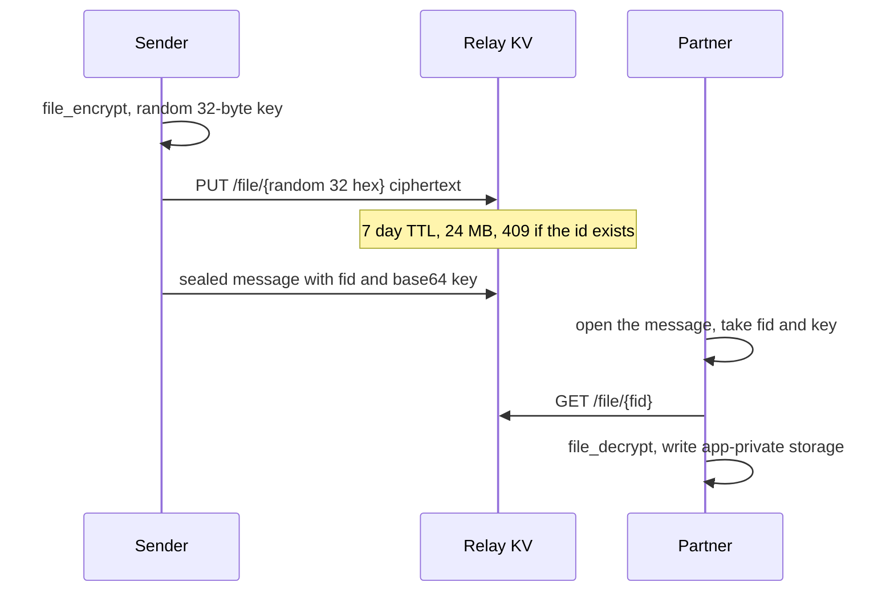
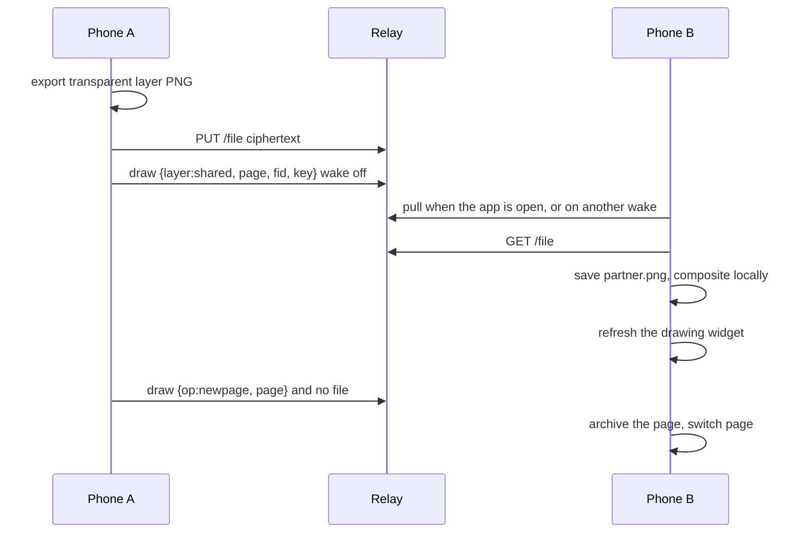
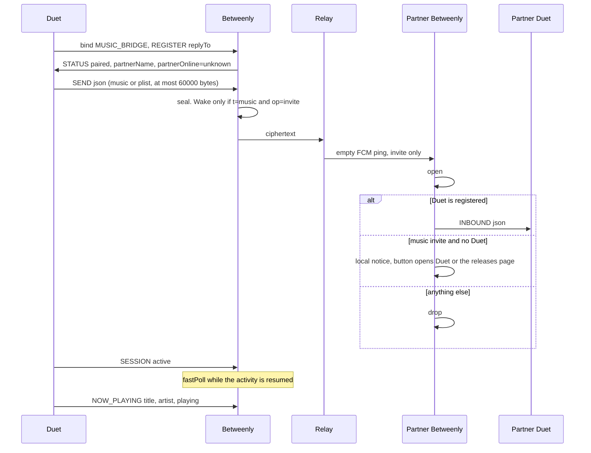
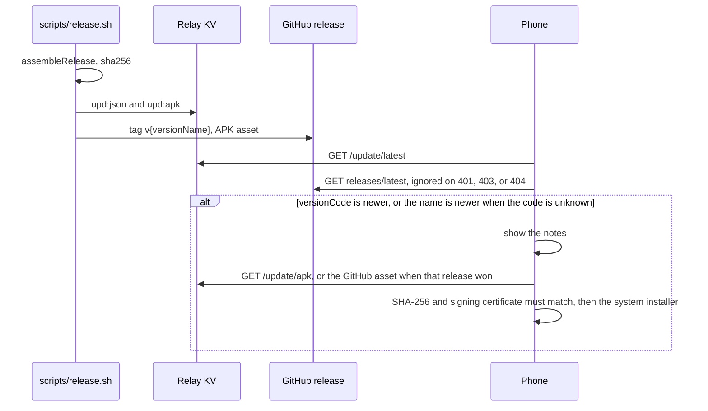

# Architecture

Betweenly (`com.nextlayer.betweenly`, version 0.0.1, version code 1). The Rust crate is `betweenly-core`. The native library is `betweenly_core`. Kotlin talks to it through `Core.kt` (JNI). The relay is a Cloudflare Worker. The phone is the only process that touches GPS, the microphone, the camera, and the media store.

```
Phone A                         Relay                              Phone B
  |  SPAKE2, then ciphertext      |                                  |
  |------------------------------>|  mailbox (ciphertext)            |
  |                               |--------------------------------->|
  |                               |  optional empty FCM {w:"1"}      |
  |                               |---------------> Google FCM ----->|
  |  GET /box (deletes blobs)     |                                  |
  |<------------------------------|                                  |
```

- **Pairing.** A shows an 8-character code. Both run SPAKE2 with that code as the password. The relay sees SPAKE2 messages and a rendezvous id that is an HKDF of the code (`betweenly-v1` / `rendezvous`). It does not see the code. Both derive one 32-byte key, two 16-byte mailbox ids, and a 6-digit safety number. Role `b` may write the handshake 3 times, then the code is burned (HTTP 429). Records expire after 10 minutes.
- **Messages.** UTF-8 JSON, a 2-byte length, zero padding to a multiple of 512 bytes, then XChaCha20-Poly1305. The nonce is 24 random bytes. The counter is authenticated as additional data and stored next to the nonce. Replays fail. Gaps are allowed. The 80-byte session lives in Android Keystore-wrapped preferences (`Secure`, alias `betweenly_wrap`).
- **Files.** A fresh 32-byte key, XChaCha20-Poly1305, additional data `file`. Ciphertext goes to `PUT /file/{id}` (24 MB cap, 7 days). The key travels only inside a sealed message.
- **Location.** An inexact alarm about every 10 minutes takes one balanced-power fix. Live is a foreground service: send on a 5 metre move or every 30 seconds. Sharing off keeps the last point on the partner’s phone. Battery is a separate encrypted `bat` message: on a 5% change or a charging change while the process is alive, and an inexact alarm about every 30 minutes, including while location sharing is off.
- **Wake.** `POST /box/{id}?wake=1` makes the worker send a high-priority FCM data message whose only field is `w` = `1`. The phone pulls the mailbox. Without Firebase keys in the build, nothing wakes a sleeping phone.
- **Updates.** `GET /update/latest`, then `GET /update/apk`, SHA-256, the same signing certificate as this install, then the system installer. A quiet check also reads `https://api.github.com/repos/aceadones/Betweenly/releases/latest` when that repo is public. A 401, 403, or 404 is ignored.
- **Map.** OpenStreetMap tiles in `TileMap.kt`. No map SDK.

## Module map

```
core/                 Rust. No network, no disk. JNI behind feature jni-api.
  src/lib.rs          Code, SPAKE2, HKDF, seal/open, file_encrypt.
  examples/partner.rs Desktop partner. Uses curl. Speaks the same JSON.

relay/src/index.ts    Worker. KV + one Durable Object mailbox per id.
android/              Kotlin + Jetpack Compose.
  App.kt              Process start: FCM init, re-arm sharing, battery watcher, one inbox pull.
  MainActivity.kt     Tabs and the foreground inbox pump (5 s, or 2 s).
  Core.kt Relay.kt    JNI and HTTPS.
  Msg.kt              JSON codecs, Outbox, Inbox. One session lock.
  Pairing.kt Store.kt Secure.kt
  LocationSharing.kt  Location alarm, battery alarm, boot receiver, one-shot fix. LiveLocationService.kt
  RingController.kt   RingService.kt
  FcmService.kt       Empty wake and token registration.
  FileTransfer.kt     Shared upload/download for chat, draw, and wall.
  MusicBridgeService.kt  Exported binder for Duet. DuetBridge.kt, DuetState.kt.
  ChatStore.kt ChatInbound.kt ui/ChatController.kt
  LinkPreview.kt ChatWallpaperSync.kt
  DrawStore.kt DrawInbound.kt
  Updater.kt
  ui/                 Compose screens, widgets, Motion, Radius, Theme, icons.
scripts/release.sh    APK, relay KV, GitHub release.
```

After pairing, one activity shows four tabs: Activity, Chat, Location, Profile. The dock is `ui/Dock.kt`. The camera is not on the dock. Icons are `ui/icons/Lu.kt`. Motion is `ui/Motion.kt`. Nested corners use `ui/Radius.kt` (inner radius = outer radius minus the gap). Profile → Reduce animations stores `animations_enabled` and makes those helpers snap.

## Pairing handshake



`Pairing.confirm` holds the inbox for up to 20 seconds so a normal wake cannot consume the partner’s profile first. If that first open fails, the session is deleted and the UI reports that the codes did not match. Polling is every 2 seconds for up to 10 minutes, and only while pairing is running.

## Message flow

```mermaid
sequenceDiagram
    participant S as Sender
    participant C as betweenly-core
    participant R as Relay mailbox
    participant F as Google FCM
    participant I as Receiver
    S->>S: JSON, strip local keys
    S->>C: pad to 512-byte multiple, seal
    C-->>S: new session (counter++) and ciphertext
    S->>S: save session before the post
    S->>R: POST /box/{outbox}?wake=1
    R->>F: data {w:"1"} if a token exists
    F->>I: onMessageReceived
    I->>R: GET /box/{inbox}
    R-->>I: blobs, queue cleared
    I->>C: open, reject replay
    I->>I: apply loc, chat, draw; hand music and plist to Duet
```

`SessionGate` serializes every seal and open. Two overlapping seals would reuse a counter.

While `MainActivity` is resumed, and the screen is not onboarding, pairing, or the privacy page, `InboxPump` pulls every 5 seconds. Duet’s `SESSION` message sets `AppState.fastPoll` and the interval becomes 2 seconds. The pump stops on pause. `App.onCreate` pulls once if already paired, and deletes a leftover music database and song copies from older builds. `FcmService` pulls when the data map contains `w`, with an 18 second cap.

Wake is on for profile, share, ring, ring-stop, ping, chat, attachments, link cards, reactions, the last live-location point, and a music invite (`t` = `music`, `op` = `invite`). Wake is off for routine `loc` and `bat`, `ringack`, unsend, wallpaper, every `draw`, every `plist`, and every other `music` op.

## Ring and ping



Ping is `{"t":"ping"}` with wake, then one local notice. It does not start `RingService`. The sender ignores a second ping for 2 seconds.

The notice text is chosen on the receiver (`NotificationTexts`). The lock-screen public version is always “Betweenly” / “Notification”.

## File transfer

Used by chat attachments, drawing layers, and wallpaper photos. Listen-together does not upload a file from Betweenly.



`FileTransfer.download` retries at 0, 3, 8, 15, and 30 seconds. Chat photos are JPEG, long edge 2048, before encryption. Videos, GIFs, stickers, and documents are capped at 20 MB of plaintext. Wallpaper JPEGs are capped at 3 MB. Drawing PNGs use the 24 MB ciphertext cap.

## Shared drawing

```
filesDir/drawings/
  shared/page          current page number
  shared/mine.png      this phone's transparent layer
  shared/partner.png   the other layer
  saved/<millis>.png   composites this phone saved
```



A `draw` with no `layer` field is a full PNG and is stored as the partner’s layer on the current page. The combined picture is not uploaded. `wake` is off, so there is no FCM ping for a drawing. The widget is RemoteViews, 30-minute `updatePeriodMillis`, and also updates when a PNG is saved. It reads local files only.

## Duet bridge

Duet (`com.nextlayer.duet`) plays the music. Betweenly only carries `music` and `plist` JSON. The service is exported, with action `com.nextlayer.betweenly.action.MUSIC_BRIDGE`. There is no custom permission. Every bind and every message requires the caller package `com.nextlayer.duet` and `checkSignatures(callingUid, myUid) == SIGNATURE_MATCH`. A debug build accepts the package name without the signature match.

Nothing in a bridge bundle is a key, a session, or a relay URL. `positionMs`, `durationMs`, and Duet’s own `ts` on a now-playing message are accepted and not stored. The card’s freshness clock is the time Betweenly received the line. It goes idle after 60 seconds. That check happens when the Activity tab resumes or when a new line arrives. There is no timer.



| `what` | Name | Direction | Bundle |
|---|---|---|---|
| 1 | `REGISTER` | Duet to Betweenly | `Message.replyTo`, or parcelable `replyTo` |
| 2 | `UNREGISTER` | Duet to Betweenly | none |
| 3 | `SEND` | Duet to Betweenly | `json` string |
| 4 | `NOW_PLAYING` | Duet to Betweenly | `title`, `artist`, `playing`, `positionMs`, `durationMs`, `ts` |
| 5 | `SESSION` | Duet to Betweenly | `active` boolean |
| 6 | `PING` | Duet to Betweenly | none |
| 7 | `INBOUND` | Betweenly to Duet | `json` string |
| 8 | `STATUS` | Betweenly to Duet | `paired` boolean, `partnerName` string, `partnerOnline` string always `unknown` |
| 9 | `ACK` | Betweenly to Duet | `ok` boolean, `req` int (the request `what`) |

`ACK` and `STATUS` go to the messenger from `REGISTER`. Duet should register before it expects them. `STATUS` is sent on register and again when the paired flag or the partner name changes. It is not sent for a location tick. `partnerOnline` is always the string `unknown`: Betweenly does not tell Duet whether the other phone is reachable.

`SEND` of any other `t`, or of UTF-8 over 60,000 bytes, is rejected. A rejected send gets `ACK` with `ok` false and is not sealed.

While `SESSION` says active, and the phone is still paired, `AppState.fastPoll` is true and the open activity pulls every 2 seconds. Unregister, a dead Duet process, or unpair sets it false. The pull still stops when the activity pauses.

An invite that Duet is not there to take is a local notice from `NotificationTexts`. The default wording is content-free. On mode says “Listen together?” and does not include the song. The button opens Duet, or `https://github.com/aceadones/Duet/releases` in the browser. Betweenly does not fetch that URL.

## Update flow



A quiet check is skipped for 6 hours after a real answer (including “nothing published”). A network error does not move that clock. Version code is compared first, so a higher code is newer even when the version name matches this install.

## Inbox apply

`Inbox` dispatches on `t`:

| `t` | Applied by |
|---|---|
| `loc`, `bat`, `share`, `profile` | `Inbox` → `Store` |
| `ping` | `ChatNotifications.onPing` |
| `ring` | `RingService.start` |
| `ringstop` | `RingService` stops the matching id |
| `ringack` | `RingController` if the id is the outgoing call |
| `chat`, `att`, `link`, `react`, `unsend`, `wall` | `ChatInbound` |
| `draw` | `DrawInbound` |
| `music`, `plist` | `DuetBridge.deliver` |

Unknown types are ignored. A blob that fails to open is skipped, except during the pairing confirm window, where a total failure means the codes did not match.

## What runs when the screen is off

| Work | When |
|---|---|
| 10-minute location alarm | Sharing on, live off. Re-armed after each tick and after boot. |
| Live location service | Only while live is on. Not started from boot. |
| FCM wake | A partner message asked for `wake`. |
| Ring service | Until dismiss, `ringstop`, or two minutes. |
| Duet bridge | Only while Duet is bound. It does not wake the phone by itself. |
| Inbox poll | Not while the activity is paused. One pull on process start. A listen-together session does not poll in the background. |

## Desktop partner

`core/examples/partner.rs` joins as role `b` and uses the same seal, open, and `file_encrypt`. It can send chat, a legacy ring, share, loc (with wake), draw, photo, sticker, gif, file, unsend, a color wallpaper, and a reaction. It does not send `music` or `plist`.
