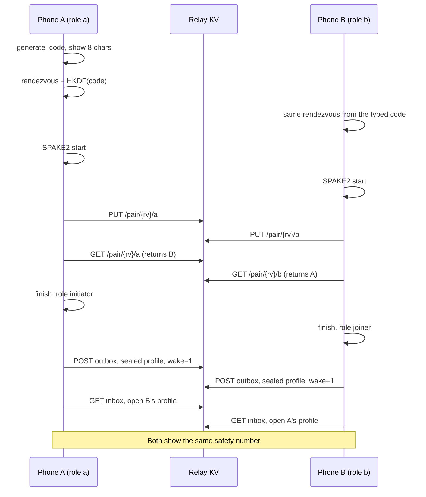
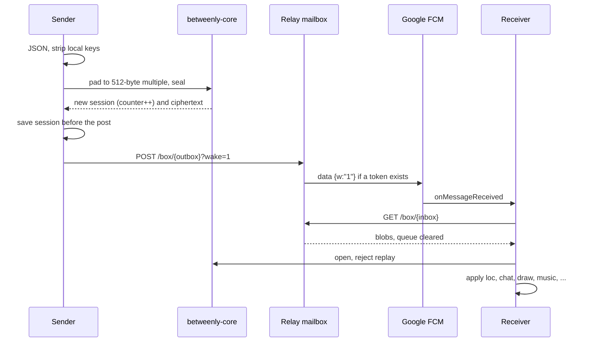
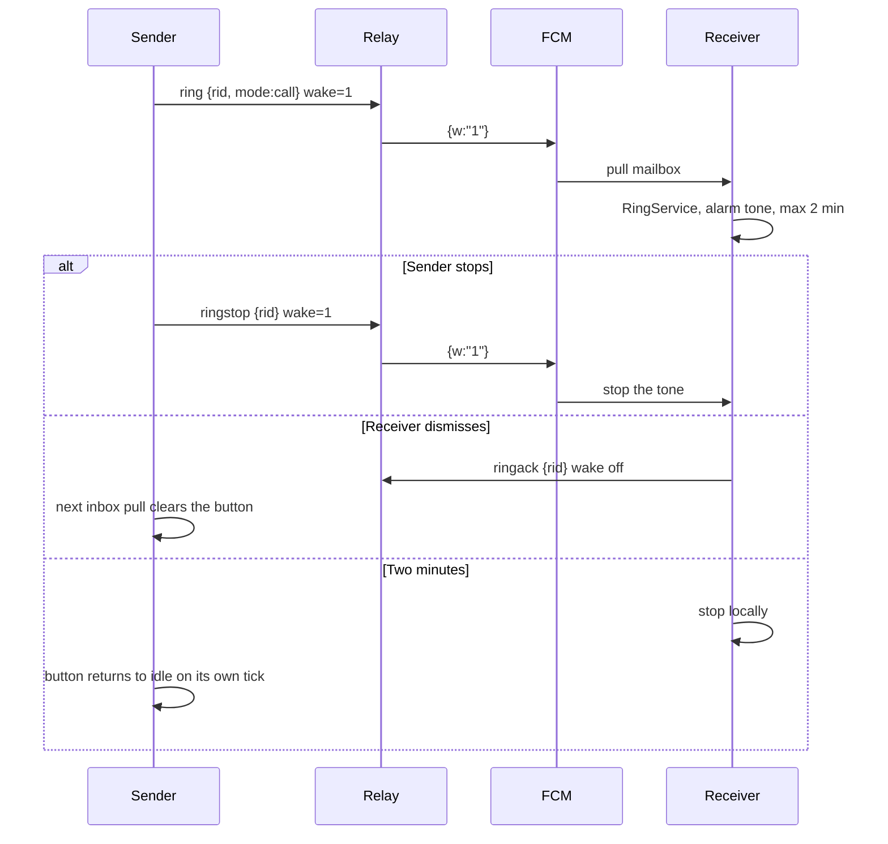
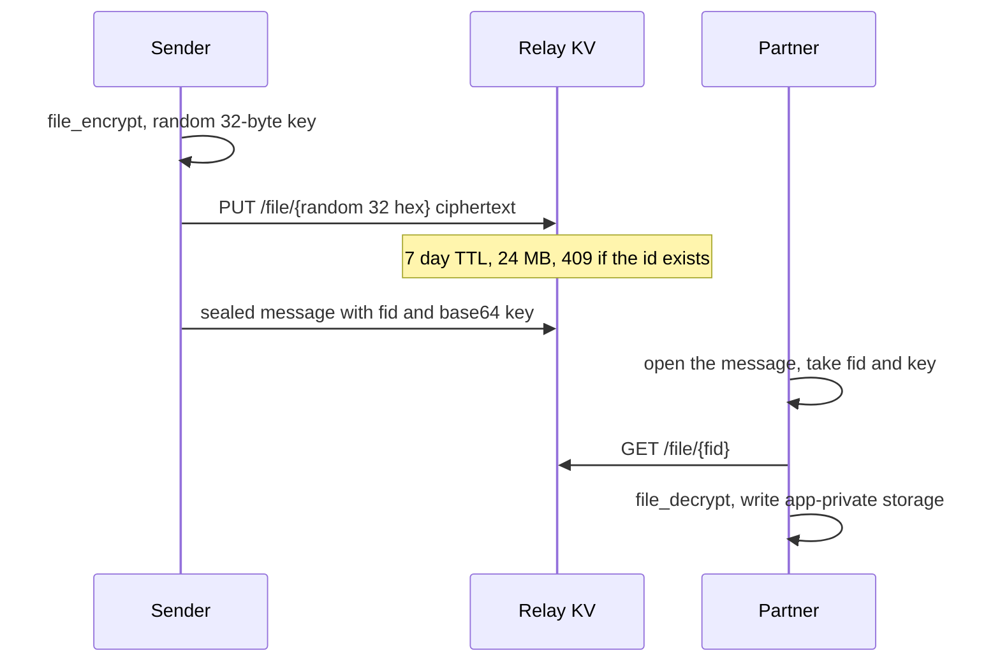
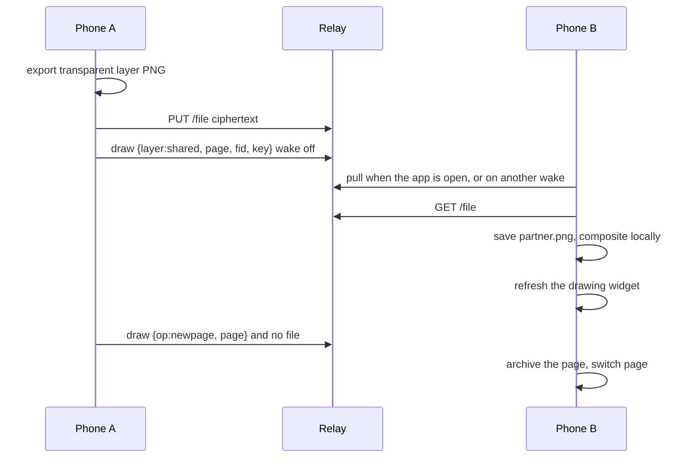
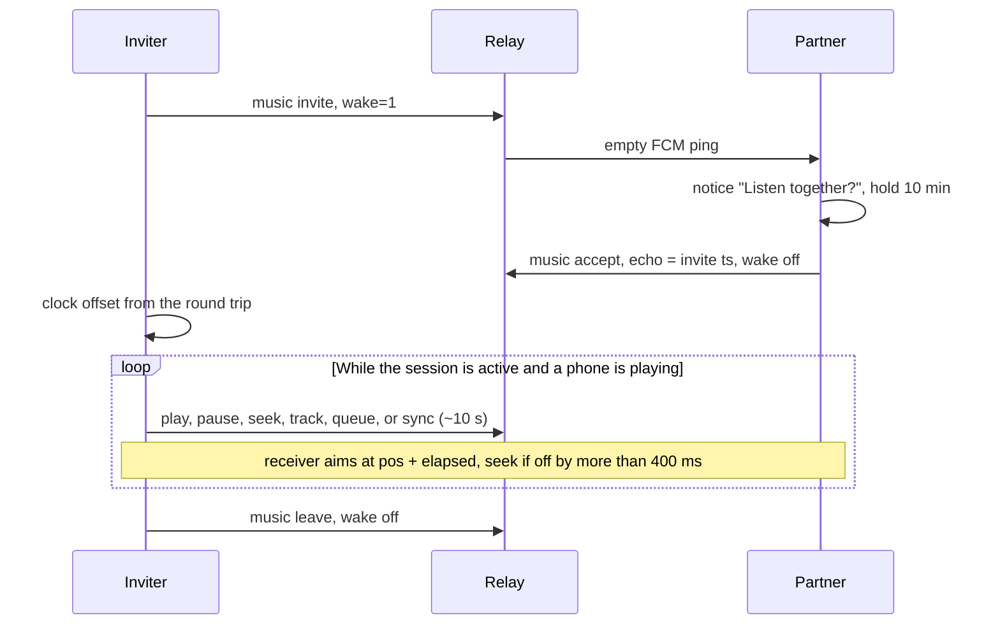
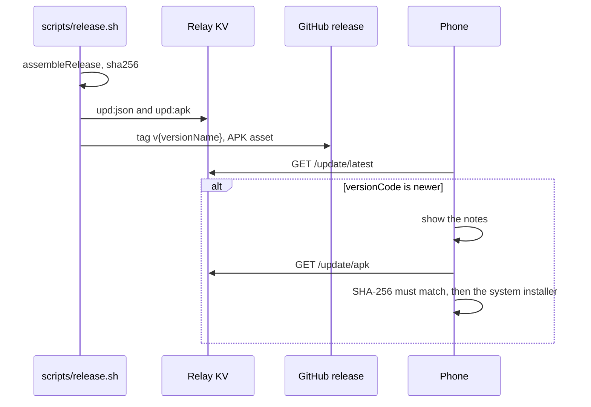

# Architecture

Betweenly (`com.nextlayer.betweenly`, version 0.0.1, version code 1). The Rust crate is `betweenly-core`. The native library is `betweenly_core`. Kotlin talks to it through `Core.kt` (JNI). The relay is a Cloudflare Worker. The phone is the only process that touches GPS, the microphone, the camera, and the media store.

```
Phone A                         Relay                              Phone B
  |  SPAKE2, then ciphertext      |                                  |
  |------------------------------>|  mailbox (ciphertext)            |
  |                               |--------------------------------->|
  |                               |  optional empty FCM {w:"1"}      |
  |                               |---------------> Google FCM ----->|
  |  GET /box (deletes blobs)     |                                  |
  |<------------------------------|                                  |
```

- **Pairing.** A shows an 8-character code. Both run SPAKE2 with that code as the password. The relay sees SPAKE2 messages and a rendezvous id that is an HKDF of the code (`betweenly-v1` / `rendezvous`). It does not see the code. Both derive one 32-byte key, two 16-byte mailbox ids, and a 6-digit safety number. Role `b` may write the handshake 3 times, then the code is burned (HTTP 429). Records expire after 10 minutes.
- **Messages.** UTF-8 JSON, a 2-byte length, zero padding to a multiple of 512 bytes, then XChaCha20-Poly1305. The nonce is 24 random bytes. The counter is authenticated as additional data and stored next to the nonce. Replays fail. Gaps are allowed. The 80-byte session lives in Android Keystore-wrapped preferences (`Secure`, alias `betweenly_wrap`).
- **Files.** A fresh 32-byte key, XChaCha20-Poly1305, additional data `file`. Ciphertext goes to `PUT /file/{id}` (24 MB cap, 7 days). The key travels only inside a sealed message.
- **Location.** An inexact alarm about every 10 minutes takes one balanced-power fix. Live is a foreground service: send on a 5 metre move or every 30 seconds. Sharing off keeps the last point on the partner’s phone.
- **Wake.** `POST /box/{id}?wake=1` makes the worker send a high-priority FCM data message whose only field is `w` = `1`. The phone pulls the mailbox. Without Firebase keys in the build, nothing wakes a sleeping phone.
- **Updates.** `GET /update/latest`, then `GET /update/apk`, then SHA-256, then the system installer. Phones do not call GitHub.
- **Map.** OpenStreetMap tiles in `TileMap.kt`. No map SDK.

## Module map

```
core/                 Rust. No network, no disk. JNI behind feature jni-api.
  src/lib.rs          Code, SPAKE2, HKDF, seal/open, file_encrypt.
  examples/partner.rs Desktop partner. Uses curl. Speaks the same JSON.

relay/src/index.ts    Worker. KV + one Durable Object mailbox per id.
android/              Kotlin + Jetpack Compose.
  App.kt              Process start: FCM init, re-arm sharing, one inbox pull.
  MainActivity.kt     Tabs and the foreground inbox pump (5 s, or 2 s).
  Core.kt Relay.kt    JNI and HTTPS.
  Msg.kt              JSON codecs, Outbox, Inbox. One session lock.
  Pairing.kt Store.kt Secure.kt
  LocationSharing.kt  Alarm, boot receiver, one-shot fix. LiveLocationService.kt
  RingController.kt   RingService.kt
  FcmService.kt       Empty wake and token registration.
  FileTransfer.kt     Shared upload/download for chat, draw, wall, music.
  ChatStore.kt ChatInbound.kt ui/ChatController.kt
  LinkPreview.kt ChatWallpaperSync.kt
  DrawStore.kt DrawInbound.kt
  music/              Player, database, wire format, background notice.
  Updater.kt
  ui/                 Compose screens, widgets, Motion, Radius, Theme, icons.
scripts/release.sh    APK, relay KV, GitHub release.
```

After pairing, one activity shows four tabs: Activity, Chat, Location, Profile. The dock is `ui/Dock.kt`. The camera is not on the dock. Icons are `ui/icons/Lu.kt`. Motion is `ui/Motion.kt`. Nested corners use `ui/Radius.kt` (inner radius = outer radius minus the gap). Profile → Reduce animations stores `animations_enabled` and makes those helpers snap.

## Pairing handshake



`Pairing.confirm` holds the inbox for up to 20 seconds so a normal wake cannot consume the partner’s profile first. If that first open fails, the session is deleted and the UI reports that the codes did not match. Polling is every 2 seconds for up to 10 minutes, and only while pairing is running.

## Message flow



`SessionGate` serializes every seal and open. Two overlapping seals would reuse a counter.

While `MainActivity` is resumed, and the screen is not onboarding, pairing, or the privacy page, `InboxPump` pulls every 5 seconds. Listen together sets `AppState.fastPoll` and the interval becomes 2 seconds. The pump stops on pause. `App.onCreate` pulls once if already paired. `FcmService` pulls when the data map contains `w`, with an 18 second cap.

Wake is on for profile, share, ring, ring-stop, ping, chat, attachments, link cards, reactions, the last live-location point, and a music invite. Wake is off for routine `loc` and `bat`, `ringack`, unsend, wallpaper, every `draw`, playlist edits, and music commands other than invite.

## Ring and ping



Ping is `{"t":"ping"}` with wake, then one local notice. It does not start `RingService`. The sender ignores a second ping for 2 seconds.

The notice text is chosen on the receiver (`NotificationTexts`). The lock-screen public version is always “Betweenly” / “Notification”.

## File transfer

Used by chat attachments, drawing layers, wallpaper photos, and shared songs.



`FileTransfer.download` retries at 0, 3, 8, 15, and 30 seconds. Chat photos are JPEG, long edge 2048, before encryption. Videos, GIFs, stickers, and documents are capped at 20 MB of plaintext. Shared audio uses the same 20 MB cap. Wallpaper JPEGs are capped at 3 MB. Drawing PNGs use the 24 MB ciphertext cap.

## Shared drawing

```
filesDir/drawings/
  shared/page          current page number
  shared/mine.png      this phone's transparent layer
  shared/partner.png   the other layer
  saved/<millis>.png   composites this phone saved
```



A `draw` with no `layer` field is a full PNG and is stored as the partner’s layer on the current page. The combined picture is not uploaded. `wake` is off, so there is no FCM ping for a drawing. The widget is RemoteViews, 30-minute `updatePeriodMillis`, and also updates when a PNG is saved. It reads local files only.

## Music sync

`MusicSession` is created when the music screen opens, not from `Application.onCreate`. Solo playback does not call `Outbox`.



A local file of 20 MB or less is uploaded once through the file path above. The partner writes `cacheDir/music` and deletes it when the session releases. Songs over 20 MB play only on the phone that has them. Online tracks are not uploaded; nothing in this build registers an online source.

Shared playlists are a separate `plist` message (`create`, `rename`, `add`, `remove`, `delete`, `snapshot`), `wake` off. Last writer wins per track id by `ts`. Turning sharing off stops sends and leaves the partner’s copy. The queue on the wire is capped at 20. The solo queue holds up to 100.

If Keep playing is on, `MusicPlayService` posts a foreground notice (“Music” / “Playing” or “Paused”, no title) and does not own the player. The switch defaults to off. Ten minutes of pause releases the session. The sleep timer is a coroutine delay.

Leaving the app while Listen together is still playing does not keep the 2-second poll. Sync waits until the activity is resumed again.

## Update flow



A quiet check is skipped for 24 hours after a real answer (including “nothing published”). A network error does not move that clock. The phone never requests GitHub.

## Inbox apply

`Inbox` dispatches on `t`:

| `t` | Applied by |
|---|---|
| `loc`, `bat`, `share`, `profile` | `Inbox` → `Store` |
| `ping` | `ChatNotifications.onPing` |
| `ring` | `RingService.start` |
| `ringstop` | `RingService` stops the matching id |
| `ringack` | `RingController` if the id is the outgoing call |
| `chat`, `att`, `link`, `react`, `unsend`, `wall` | `ChatInbound` |
| `draw` | `DrawInbound` |
| `music`, `plist` | `MusicInbound` |

Unknown types are ignored. A blob that fails to open is skipped, except during the pairing confirm window, where a total failure means the codes did not match.

## What runs when the screen is off

| Work | When |
|---|---|
| 10-minute location alarm | Sharing on, live off. Re-armed after each tick and after boot. |
| Live location service | Only while live is on. Not started from boot. |
| FCM wake | A partner message asked for `wake`. |
| Ring service | Until dismiss, `ringstop`, or two minutes. |
| Music foreground notice | Only if Keep playing is on and a track is loaded. |
| Inbox poll | Not while the activity is paused. One pull on process start. |

## Desktop partner

`core/examples/partner.rs` joins as role `b` and uses the same seal, open, and `file_encrypt`. It can send chat, a legacy ring, share, loc (with wake), draw, photo, sticker, gif, file, unsend, a color wallpaper, and a reaction. It does not send `music` or `plist`.
